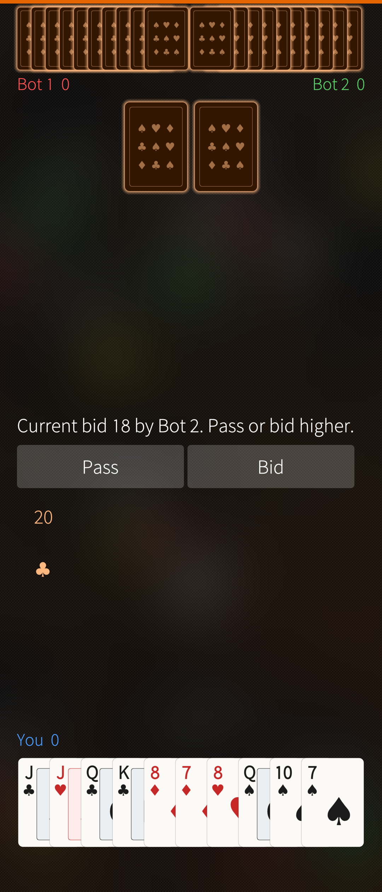
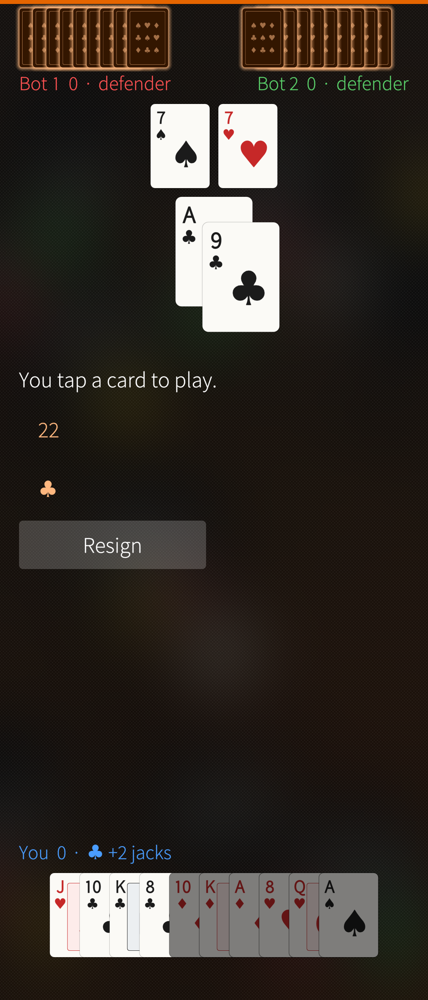
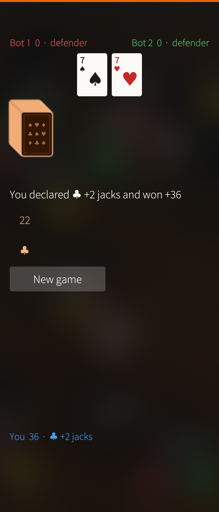

# SailSkaat
A qml/js Skat game for SailfishOS. https://en.wikipedia.org/wiki/Skat_(card_game)

# Install 

You can install from chum, harbour direct download here from releases or using harpoon.

 
